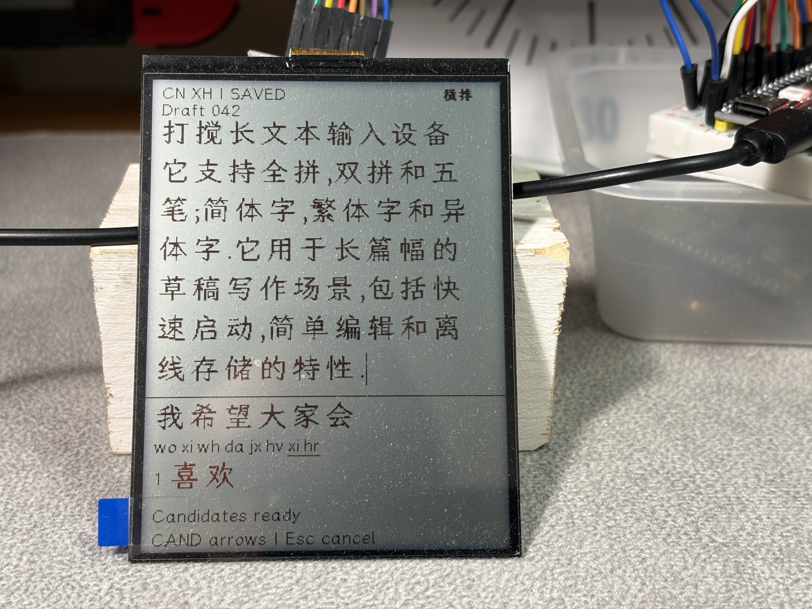

# Draftor

[简体中文](README.md) | **English**

Draftor is an open-source, portable Chinese writing device built around a microcontroller. It uses a Bluetooth keyboard and supports offline writing and local document storage.

It aims to provide a distraction-free writing experience: no internet connection is needed, there are no AI writing features, and the device keeps to basic editing and document transfer.

## Latest release: Alpha 3 — Waveshare

Alpha 3 for the Waveshare ESP32-S3-RLCD-4.2 introduces learning from word selection: words that you select repeatedly can move higher in the candidate list. Full Pinyin, Xiaohe Shuangpin, and Wubi 86 share these learned preferences.

Up to seven single-character candidates appear per row in horizontal layout or per column in vertical layout. Multi-character candidates use the space they need (four two-character candidates or two three-character candidates per row). Bluetooth keyboard connection is faster, and switching between previously paired keyboards is easier.

| Hardware | Alpha 3 availability | Download and instructions |
|---|---|---|
| Waveshare ESP32-S3-RLCD-4.2 (ST7305) | **First release batch** | [Firmware and matching resources](https://github.com/Ohhellboy/Draftor/releases) · [Installation](docs/INSTALL.md) |
| Original ESP32-S3 N16R8 + Osptek ST7306 | Alpha 3 to follow | [Earlier releases](https://github.com/Ohhellboy/Draftor/releases) |
| Raspberry Pi Pico 2 W | Alpha 3 to follow | [Hardware notes](docs/HARDWARE.md) |

All three hardware variants will share the Alpha 3 name, but **their firmware images are not interchangeable**. This release batch is for the Waveshare board only. [Read the Waveshare Alpha 3 release notes](docs/RELEASE_NOTES.md).

## Features and hardware

| Feature | Support |
|---|---|
| Chinese input | Full Pinyin, Xiaohe Shuangpin, and Wubi 86 |
| English input | Direct English input |
| Character display | Simplified, Traditional, and variant Chinese characters using the supplied font resources |
| Writing layout | Horizontal and vertical |
| Document management | Local saving, Chinese file menus, renaming, trash and help |
| Find in a manuscript | Chinese and English queries, forward/backward search and wraparound in both layouts |
| Document transfer | Import and export over USB and local Wi-Fi |

The project supports two ESP32-S3 hardware variants: the **Waveshare ESP32-S3-RLCD-4.2** with an integrated ST7305 display and TF slot, and the original **ESP32-S3 N16R8 + Osptek ST7306** with external display and TF modules. **The Alpha 3 firmware in this release is only for the Waveshare board**. The original board's Alpha 3 build will follow; its earlier firmware remains available in [GitHub Releases](https://github.com/Ohhellboy/Draftor/releases).

The repository also provides standalone ST7306 display examples for the Raspberry Pi Pico 2 W. See [Hardware](docs/HARDWARE.md) for requirements and differences.

## Getting started

### Install the firmware

Get the **Waveshare Alpha 3 firmware and matching resources** from [GitHub Releases](https://github.com/Ohhellboy/Draftor/releases), then follow the [installation guide](docs/INSTALL.md). Do not flash this image to the original ST7306 board or Pico 2 W.

Existing compatible dictionaries and fonts can be retained on the TF card, but Alpha 3 also needs its matching learning index. Follow the installation guide for manuscript and learning directories; **updating the firmware alone does not migrate old manuscripts**. Back up your writing and any existing learning records before upgrading.

### Write and transfer documents

The [user guide](docs/USAGE.md) covers keyboard shortcuts, Chinese input, Find, renaming documents, and transferring files over USB and local Wi-Fi.

Alpha 3 remains a test release, and local Wi-Fi document transfer is experimental. Back up important writing regularly; see [Known Issues](docs/KNOWN_ISSUES.md).

### Build from source

Use the source and build inputs corresponding to the Waveshare Alpha 3 release, and select the Waveshare target according to the [build guide](docs/BUILD.md). The device also needs compatible TF resources. Other Alpha 3 targets will be supplied with their respective release batches.

GitHub's automatically generated “Source code” archives are repository snapshots. To install the device, use the matching files supplied on the release page.

## Chinese input: bgIME

Draftor's Chinese input is provided by **bgIME — the Big Goose Input Method Engine**.

bgIME is designed for embedded devices with limited memory. It supports Full Pinyin, Xiaohe Shuangpin, and Wubi 86. Each scheme has its own encoding rules, while sharing lexical resources, candidate lookup, and text submission.

Its Core can be built independently, and the repository includes command-line examples for other projects to explore and integrate. Draftor combines the engine with Bluetooth keyboard input, an editor, screen rendering, and document transfer.

[Explore bgIME, its examples, and integration guide](ime/bgime/README.en.md)

---

## WHY DO WE NEED A DISTRACTION-FREE TEXT RECORDING DEVICE?

Many people, including me, are easily distracted.

The personal reasons for distraction are complex and cannot simply be reduced to “you are a useless guy.” Someone might be troubled by anxiety, PTSD, depression, or ADHD; someone else might simply be affected by an occasional low mood that occurs in summer.

More importantly, there are too many things that distract us: WhatsApp, WeChat, email, social media, shopping websites, and god damn TikTok.

Writing can be a form of self-healing. It helps us rethink our behaviour and clear our minds. This is a process we have to do ourselves. Reading, studying, working, creating, and speaking cannot completely replace writing.

Writing is also a way of learning and thinking through haptic feedback.

We have to accept the limits imposed by millions of years of biological evolution. For many people, deep thinking is difficult to separate from tactile experience, even if they may not realize it. Even copying things out by hand better matches some people’s memory habits, including mine.

Friction is not always a bad thing.

I really enjoy the friction of an HB pencil on paper when I write in my notebook. It often makes me write a little more — authentic nonsense, handmade.

Many people still prefer to do their own writing.

AI can indeed simulate a specific writing style extremely well, but that is not the same as personal expression. Writing experience can be digitized, but it is difficult to make it personal without lived experience in the real world.

If you work with text — for example, as a novelist or an anthropologist — it may be easier to appreciate this.

---

## WHY CHOOSE DRAFTOR?

### Because it supports Chinese input

WriterDeck is already a relatively established category of portable, distraction-free text recording devices in markets dominated by Latin-alphabet languages. Electronic typewriters with displays have existed for nearly half a century.

However, most WriterDecks and thermal typewriters do not support Chinese input.

Devices such as the AlphaSmart, Freewrite, Brother EP-22, and Canon TypeStar 5 were not designed around Chinese input. Sharp, Casio, and other manufacturers did produce word processors capable of handling Chinese, but their Chinese input methods no longer match contemporary input habits.

Some require character-by-character input, which is very different from how people normally use modern Chinese input methods.

### Because it is designed for long-form text

Chinese PDAs were personal digital terminals, not dedicated long-form writing devices.

Popular e-readers such as Kindle and iReader are designed primarily for reading, not writing.

Some of these devices have awkward input interfaces, while others cannot provide the fast candidate response that Chinese input requires.

Friction is not always a bad thing, but it is not necessarily a good thing either.

### Old equipment comes with other costs

Old laptops, tablets, mobile phones, and Chinese word processors can be very good for text input and editing, provided that you can accept their limitations: weight, battery life, file transfer, and other practical restrictions.

I like the fold-out keyboard on the Nokia 6822, for example, but its screen is too small and, for my purposes, it lacks usable Wi-Fi, Bluetooth file transfer, and a practical USB interface.

### Functions are distractions

Many of the devices mentioned above run Linux, OS X, Windows, iOS, BBOS, Symbian OS, or other operating systems.

They have many functions. Some can even run video games.

Those functions are potential sources of distraction.

For someone who can spend five minutes playing with a toggle switch, those functions are enough to kill writing.

### Cost matters too

Here, by “cost”, I also mean the time and effort required to modify and adapt equipment.

Some classic devices are now expensive collectibles rather than practical tools.

### Faster than handwriting

I make my own A5 notebooks and take notes in pencil.

But writing by hand is hard on the hands, and speed is also a real problem.

Friction might be a good thing, but tenosynovitis is not.

---

In short, if you need a distraction-free long-text recording device with Chinese input methods, do not want to spend too much time adapting old equipment, and want something faster than handwriting, Draftor may be a good choice.

**Source code and documentation will be added here progressively as the project develops.**

## Development and licensing

Project-owned Draftor source is released under [Apache License 2.0](LICENSE). The standalone ST7306 display module retains its MIT license. Fonts, dictionaries, and other third-party materials retain their respective licensing and attribution requirements.

[Build guide](docs/BUILD.md) · [bgIME input engine](ime/bgime/README.en.md) · [ST7306 display module](display/st7306/) · [Third-party notices](THIRD_PARTY.md) · [Resources and licensing](docs/RESOURCE_STATUS.md)

Questions, problems, and suggestions are welcome through [GitHub Issues](https://github.com/Ohhellboy/Draftor/issues).
