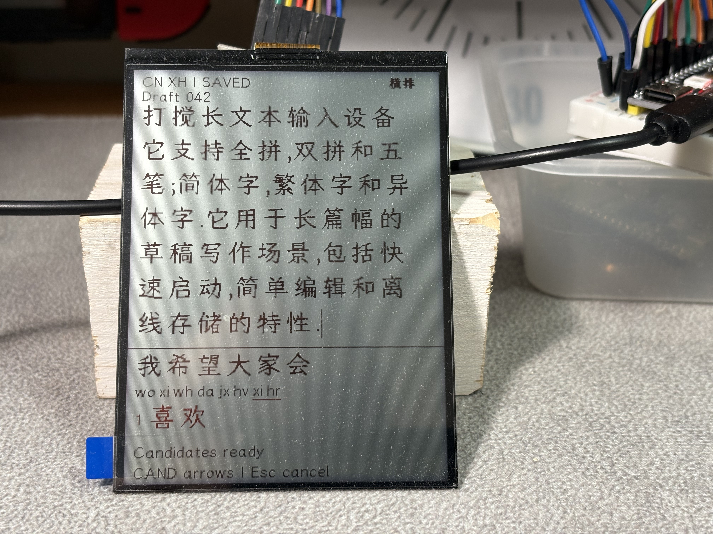

# Draftor 草稿机

**简体中文** | [English](README.en.md)

草稿机是一台基于单片机的开源便携式中文写作设备，使用蓝牙键盘输入，支持离线写作和本地文稿保存。

它希望提供一种无打搅的写作方式：无需联网，没有 AI 写作功能，保留基本编辑和文稿传输功能。

## 最新更新：Alpha 2.2 · 微雪一体板

Alpha 2.2 为草稿机增加了 **微雪 ESP32-S3-RLCD-4.2** 的支持。主控、4.2 英寸黑白反射屏和 TF 卡槽集成在一块板上，搭建时少了不少接线工作。连接蓝牙键盘、准备好配套 TF 卡，就可以继续使用草稿机进行离线中文写作。

全拼、小鹤双拼、五笔 86、横竖排、中文查找和文稿管理等功能继续保留。这次还改善了多功能蓝牙键盘的兼容性，整理了黑白屏下的候选焦点和中文菜单提示，并修正了一种文稿重新打开时的存储提示误报。

[下载 Alpha 2.2](https://github.com/Ohhellboy/Draftor/releases/tag/v0.1.0-alpha.2.2) · [完整更新说明](docs/RELEASE_NOTES.zh-CN.md) · [安装指南](docs/INSTALL.zh-CN.md) · [操作手册](docs/USAGE.zh-CN.md) · [原机 Alpha 2.1](https://github.com/Ohhellboy/Draftor/releases/tag/v0.1.0-alpha.2.1)

## 主要功能与硬件

| 功能 | 支持内容 |
|---|---|
| 中文输入 | 全拼、小鹤双拼、五笔86 |
| 英文输入 | 英文直接输入 |
| 文字显示 | 使用配套字库显示简体、繁体与异体汉字 |
| 排版 | 横排和竖排 |
| 文稿管理 | 本地保存、中文文件列表、重命名、回收站和帮助 |
| 文内查找 | 中文及英文查询、前后查找与回绕，适配横排和竖排 |
| 文稿传输 | USB 导入导出；实验性本地 Wi-Fi 传输 |

目前的 ESP32-S3 完整写作固件有两套硬件配置：

**微雪 ESP32-S3-RLCD-4.2：** 使用板载 ST7305 黑白反射屏和 TF 卡槽，对应 Alpha 2.2 固件。

**原 ESP32-S3 N16R8＋Osptek ST7306：** 使用独立的黑白红反射屏和 TF 模块，继续使用 Alpha 2.1 固件。

仓库也提供 Raspberry Pi Pico 2 W 的独立 ST7306 显示示例。接线、设备要求及硬件差异见[硬件说明](docs/HARDWARE.md)。

## 开始使用

### 安装固件

根据使用的硬件下载对应的固件包：

微雪一体板使用 [Alpha 2.2 Firmware](https://github.com/Ohhellboy/Draftor/releases/download/v0.1.0-alpha.2.2/Draftor_v0.1.0-alpha.2.2_WAVESHARE_RLCD42_Firmware.zip)，原 ST7306 原型机继续使用 [Alpha 2.1](https://github.com/Ohhellboy/Draftor/releases/tag/v0.1.0-alpha.2.1)。

微雪版本继续使用 Alpha 2.1 的[词库、索引与字体资源](https://github.com/Ohhellboy/Draftor/releases/download/v0.1.0-alpha.2.1/Draftor_v0.1.0-alpha.2.1_Resources.zip)。如果 TF 卡已经准备好这些资源，可以直接复用。

安装指南区分首次安装和已有兼容分区的固件更新。首次安装会清除设备内部 Flash，请提前备份需要保留的内容；无需格式化 TF 卡。

### 写作和传输

[操作手册](docs/USAGE.zh-CN.md)介绍中文输入、横竖排、查找、文稿管理，以及 USB 和本地 Wi-Fi 文稿传输。

Alpha 2.2 仍是测试版本，本地 Wi-Fi 传输属于实验功能。重要文稿请定期导出备份，其他使用限制见[已知问题](docs/KNOWN_ISSUES.md)。

### 自行编译

使用 Alpha 2.2 的 **Source** 和配套的 Alpha 2.1 **BuildInputs**，按照[构建指南](docs/BUILD.md)准备工具链并选择对应硬件目标。运行时仍需要配套的 TF 资源。

GitHub 自动生成的 Source code 压缩包是仓库快照。安装设备请使用发行页提供的固件及配套文件。

## 中文输入引擎：bgIME 大鹅输入法

草稿机的中文输入由 **bgIME（大鹅中文输入法引擎，Big Goose Input Method Engine）** 提供。

bgIME 为内存有限的嵌入式设备设计，支持全拼、小鹤双拼和五笔86。不同输入方案使用各自的编码规则，同时共享词条资源、候选查询和文本提交机制。

引擎核心可以独立编译，仓库中提供了命令行示例，供其他项目参考和集成。草稿机则将它与蓝牙键盘、编辑器、屏幕显示和文稿传输组合起来。

[了解 bgIME、运行示例与集成方法](ime/bgime/README.md)

---

## 为什么需要无打搅记录设备？

很多人（包括我自己）容易分心。

分心的个体原因挺复杂的，不是简单的「你这个人就是不行」可以概括。有些人长期陷于焦虑、抑郁或者注意力缺失的困境；有些人则时不时遭受夏日小情绪的困扰。

更糟糕的是，很多东西让人分心。微信、WhatsApp、邮件、社交媒体、购物网站，以及该死的钉钉和抖音。

写作是一种自愈的方法，它帮助人审视自己的行为，整理自己的想法。这个过程必须由自己完成。阅读、学习、工作、创作、闲聊，都无法完全替代写作。

写作还是一种通过触觉反馈学习和思考的方法。

我们不得不接受百万年生物演化的限制。有很多人无法脱离触觉完成深度认知过程，即便他们没意识到这一点。甚至抄写更符合一些人（包括我）的记忆习惯。

摩擦不一定是坏事。

我非常享受 HB 铅笔在纸面摩擦的反馈。它常常让我不由自主多记几笔（正宗废话，手工制造）。

很多人依然喜欢自己写作。

当今的 AI 确实可以完美模拟出具体的风格，但那不是个性的表达。写作经验可以被数据化，但很难脱离现实经验被个性化。

如果你是文本工作者，譬如文学创作者和人类学学者，可能更容易体会到这一点。

---

## 为什么选择草稿机？

### 因为它有中文输入

WriterDeck（书写板？我不知道该怎么翻译了）是拉丁语系市场相对固定的离线便携文本记录产品品类，带液晶屏的打字机也快有半个世纪的历史。

但是大多数 WriterDeck 和热敏打字机不兼容中文。

那些知名的记录设备不是按照中文输入设计的，譬如 AlphaSmart、Freewrite、兄弟 EP-22 和佳能 TypeStar 5。而像夏普、卡西欧在 1980s 前后推出的中文处理器，它们的中文输入方式已经不符合今天的中文输入习惯。

有的设备只支持单个汉字的输入方式，这几乎已经被淘汰了。

### 因为它为长文本输入设计

中文掌上电脑（譬如曾经的商务通）是个人数据终端，而非长文本写作设备。

当下流行的 Kindle、掌阅之类的电纸书也是为了阅读而非写作设计的。

有些设备的文本输入交互设计得相当诡异，有些则受限于低刷新率的屏幕，达不到中文候选词的高速要求。

摩擦不总是坏事，但也不一定是好事。

### 老设备有其他成本

老笔记本电脑、老平板、老手机、老中文处理机在中文输入和编辑上，都很好，但前提是你得接受它们的重量、续航和其他限制。

我喜欢 Nokia 6822 的折叠键盘，但它屏幕太小，没有可用的 Wi-Fi 功能和蓝牙文件传输功能。

### 功能即干扰

上述提到的很多设备，基于 Linux、OS X、Windows、iOS、BBOS、Symbian OS 或者其他操作系统研发。

它们功能繁复，自带游戏。

成为潜在的干扰源。

对一个切换按钮都能玩 5 分钟的人来说，这些功能足以杀死写作。

### 成本高昂

这里说的成本，包括了改造和适应旧设备的时间成本。

某些经典型号可能价格昂贵，它们按收藏品销售，而不是以老工具定价。

### 比手写快

我自制 A5 大小的笔记本，并用铅笔记录。

但是手写除了费手，在速度上也确实是个问题。

摩擦可能是好事，但腱鞘炎从来都不是。

---

总之，如果你需要一台无打搅便携中文输入设备，并且不想在旧器材上花费太多时间，还希望比手写更快，草稿机可能会是一个好选择。

**欢迎收藏。草稿机项目的开发、源代码和文档将在此逐步更新。**

## 开发与许可

Draftor 自有源码采用 [Apache License 2.0](LICENSE)。独立 ST7306 显示模块保留其 MIT 许可证，字体、词库及其他第三方材料适用各自的许可与署名要求。

[构建指南](docs/BUILD.md) · [bgIME 输入引擎](ime/bgime/README.md) · [ST7306 显示模块](display/st7306/) · [第三方声明](THIRD_PARTY.md) · [资源与许可说明](docs/RESOURCE_STATUS.md)

使用问题和建议，欢迎通过 [GitHub Issues](https://github.com/Ohhellboy/Draftor/issues)反馈。
